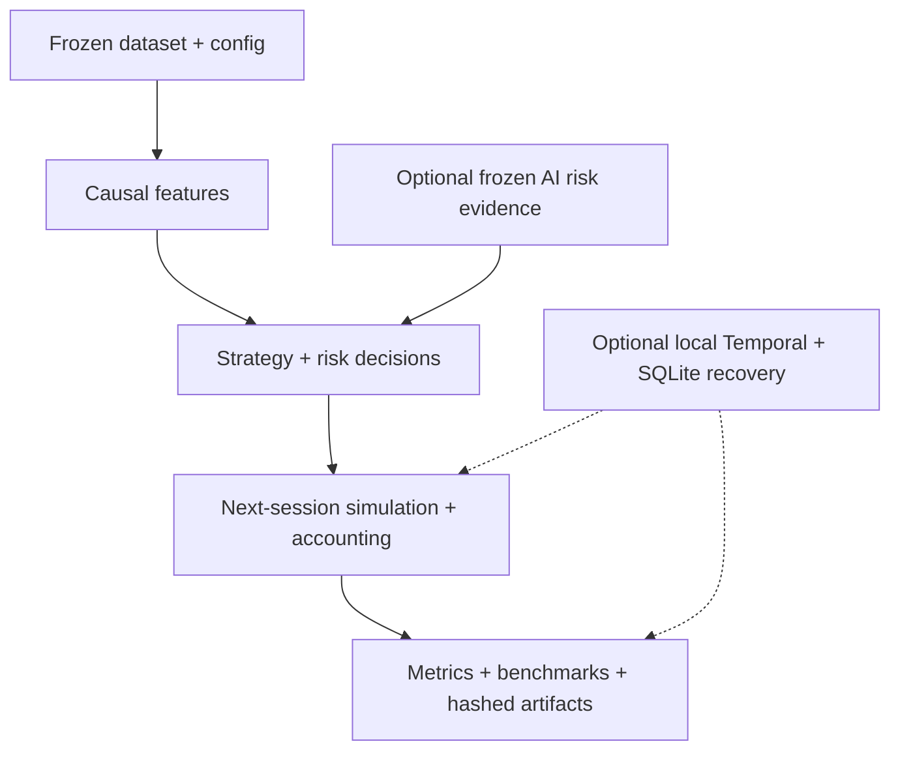

# AI-Assisted Quantitative Trading Research Framework

**Engineering implementation verified; historical empirical research pending.**

An offline Python framework that connects provenance-checked datasets, causal features,
deterministic strategy and risk decisions, next-session simulation, evaluation and
hash-indexed artifacts. A separate local Temporal/SQLite track verifies retries,
idempotence, reconciliation and workflow replay against the same research core.

The research objectives are to assess deterministic strategy robustness and the
incremental effect of a negative-only AI/news risk overlay. The systems objective is
to verify state recovery, idempotence and replay. The public demonstration uses
synthetic data and supports software-correctness and local-reliability claims;
historical strategy performance and empirical AI benefit remain unverified.

**Start here:** [final technical handoff](docs/research/FINAL_PROJECT_HANDOFF.md) ·
[reproduce the public example](docs/research/REPRODUCIBILITY.md) ·
[historical-data feasibility decision](docs/research/FINAL_DATA_FEASIBILITY.md)

Maintainer: Michail Athanasios Peppas, NTUA Electrical and Computer Engineering.

## What the engineering demonstrates

- **Causal decisions and execution:** feature warm-up, information cutoffs, next-eligible
  session fills, gaps/stops, deterministic simultaneous-order handling and rejected decisions.
- **Auditable accounting:** cash, positions, fees, slippage, realized/unrealized P&L and
  terminal holdings, checked against independent numerical fixtures.
- **Reproducible evaluation:** chronological folds, explicit benchmarks, fixed ablations,
  cost stresses, undefined metric reasons and fixed-seed uncertainty calculations.
- **Bounded AI behavior:** frozen timestamp-valid news/output replay, neutral fallback
  and negative-only effects that cannot create trades or increase deterministic exposure.
- **Local systems reliability:** actual Temporal SDK workflow execution/replay, SQLite
  lifecycle records, exactly-once observable committed results and fail-closed recovery
  across separate database and filesystem publication boundaries.
- **Historical-data safety:** compatible v1/v2 contracts, isolated split/dividend accounting,
  explicit read-only acquisition, durable budgets and immutable audit evidence, including
  failed dataset qualifications.

The long-only baseline, relative-strength filter, risk limits and accepted numerical
behavior are preserved. Positive returns and a minimum trade count are not acceptance criteria.

## Architecture and technology



Python 3.12+ and Pydantic provide typed, versioned boundaries; `uv.lock` pins dependencies.
SQLite supplies local transactional audit state. Temporal's local SDK test environment
exercises orchestration and replay without a cloud service. Pytest, Ruff and scoped
mypy checks qualify the implementation. The ordinary research CLI needs no running
Temporal service or credentials. Legacy operational components are historical context.

## Run the connected synthetic example

Initial cloning and dependency installation may need internet access. The experiment
itself uses only public fixtures and runs offline after setup.

```bash
git clone https://github.com/ntua-el21026/ai-assisted-quant-research.git
cd ai-assisted-quant-research
uv sync --locked --group dev
uv run --offline --no-sync python -m packages.research.cli run \
  --config experiments/configs/baseline.yaml \
  --dataset tests/fixtures/market_snapshot/manifest.json \
  --output results/example
```

Use a new output directory each time; existing results are immutable. The output contains
`manifest.json`, the effective configuration, decision/fill records in `trades.csv`,
`equity.csv`, `metrics.json`, explicit comparison status, a generated `report.md`,
`hashes.json` and separate nondeterministic `runtime.json`.

The fixed **synthetic** fixture has 210 weekday sessions and 630 invented OHLCV rows.
Its one closed round trip starts from USD 10,000 and ends at USD **9,980.4831136**, with
no terminal position. Independent arithmetic checks the loss of USD 19.5168864 and
fees of USD 0.0328864. These numbers verify modeled execution/accounting and provide
no historical investment inference. The fixture calendar is not an exchange calendar.

[Reproducibility instructions](docs/research/REPRODUCIBILITY.md) give the executed two-run
sequence, exact inventory/hash verification, expected output and optional existing
matrix, corporate-action and local workflow demonstrations. The `run` command records
causal decisions and accounting; `evaluate` adds chronological experiments, benchmarks,
statistical comparisons and frozen AI controls.

## Verification status

At the [engineering closure](docs/research/FINAL_PROJECT_HANDOFF.md),
**1,521 tests passed and nine gated external-service tests were skipped**,
with three existing Temporal/Pydantic warnings. Repository-wide Ruff, the established
59-file mypy scope, dependency/lock consistency, frontend-only checks and local Temporal
recovery/replay passed. Repeated artifact sets were byte-identical. Across revisions,
238 generated artifact files matched accepted baseline bytes; this comparison excludes
runtime metadata and revision-dependent manifests/reports. Commands, environment, hashes, exclusions and
clean-install evidence are consolidated in [the final handoff](docs/research/FINAL_PROJECT_HANDOFF.md).

Reproducibility is defined for the same dataset, configuration, code revision and recorded
environment. Runtime timestamps/host details are excluded. Full source-bound aggregate
hashes can change with a new revision while protected numerical files remain unchanged.
Local recovery tests do not prove production, distributed-concurrency or power-loss guarantees.

## Historical empirical status

**No historical strategy study has executed. The full v0.7 research-completion gate remains open.**
The final finite review evaluated the existing private Alpaca IEX pilot and three alternative
sources. It established no sufficiently qualified, already-authorized dataset for a restricted
multiyear study. No alternate temporal split, strategy threshold, holdout or risk limit was
registered or changed. A SPY-only substitute would also defeat the existing positive
relative-strength filter because SPY's relative strength against itself is zero.

The existing pilot's internally valid bars do not resolve corporate-action fields,
identity, aggregation/execution, historical availability or rights requirements.
The [source decision](docs/research/FINAL_DATA_FEASIBILITY.md) records the bounded review;
the [handoff appendix](docs/research/FINAL_PROJECT_HANDOFF.md#historical-research-gates)
retains the seven scientific/rights gate groups. No proprietary observations, empirical
charts or uncertain-rights derived statistics are published. Historical AI evidence remains
unqualified, so no empirical AI-uplift claim is made. The research program remains in
development; the verified engineering deliverable is ready for portfolio review.

## Technical reports and source map

| Start point | Evidence or implementation |
| --- | --- |
| [Specification v0.7](docs/app/AI_Assisted_Quant_Research_SPEC_v0.7.md) and [protocol](docs/research/RESEARCH_PROTOCOL.md) | Scientific contracts, hypotheses, execution and completion gates |
| [Architecture](docs/research/ARCHITECTURE.md) | Actual boundaries and local recovery lifecycle |
| [R1 contracts](docs/research/R1_IMPLEMENTATION.md) / [verification](docs/research/R1_VERIFICATION.md) | Causal data, decisions and simulation |
| [R2 verification](docs/research/R2_VERIFICATION.md) | Metrics, experiment matrix and frozen AI controls |
| [R3 verification](docs/research/R3_VERIFICATION.md) | Actual workflows, recovery and replay limits |
| [R4-A contracts](docs/research/R4A_IMPLEMENTATION.md) | Exact corporate-action and benchmark accounting |
| [R4-B.2 qualification](docs/research/R4B2_DATA_QUALIFICATION.md) | Preserved private-pilot blockers and field evidence |
| [Documentation index](docs/README.md) | Detailed checkpoint reports and historical references |

`packages/data`, `packages/strategy`, `packages/risk`, `packages/backtesting` and
`packages/research` contain the offline pipeline. `apps/workers` contains optional local
orchestration; `tests` contains unit, integration and local Temporal coverage. Private
inputs and generated results are ignored by default. Public synthetic fixtures remain
available without provider access.

## Scope and license

No deployment, autonomous trading, live orders or broker-connected paper trading is
part of this release. Legacy adapters, operational scripts, disabled deployment material
and [earlier specifications](docs/app/Autonomous_AI_Trading_Bot_SPEC_v0.6.md) remain preserved
as historical evidence, not instructions to activate them.

Source code is [MIT licensed](LICENSE); original synthetic fixtures declare their own
license. Provider market/news data and issuer documents retain their separate rights.
The repository license does not grant redistribution rights over those materials.
