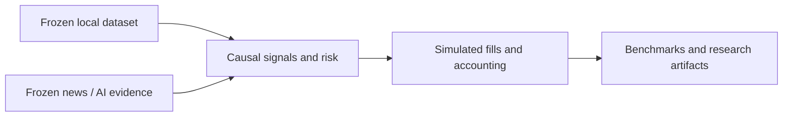

# AI-Assisted Quantitative Trading Research Framework

**Offline quantitative research · bounded AI/news evaluation · reproducible systems experiments**

This repository contains a Python research framework for studying deterministic US equity/ETF strategies, testing whether a constrained AI news-risk overlay adds value, and examining the reliability of locally orchestrated research workflows. It combines quantitative experimentation with software-engineering correctness, rather than aiming to operate a trading account.

- **Maintainer:** Michail Athanasios Peppas
- **Project direction:** v0.7 research framework (Option B)
- **Current status:** **Research transition in progress — not yet a completed experimental study**

> **No deployment, live trading or broker-connected paper trading is part of this project scope.** The canonical research path is designed to run locally and offline. Backtested returns, if produced later, will not be represented as forecasts or investment recommendations.

## Research questions

1. **Strategy robustness:** How do regime, trend, breakout, relative-strength and risk filters compare with transparent benchmarks under time-aware validation and changing costs?
2. **Bounded AI contribution:** Does frozen, timestamp-valid, negative-only news-risk analysis improve or worsen results compared with identical deterministic decisions and neutral AI?
3. **Systems correctness:** Can locally orchestrated computations preserve idempotency, auditability and state integrity under retries, replay and injected failures?

The evaluation is designed to report negative or inconclusive findings as faithfully as positive ones. No profitability threshold is a completion requirement.

## What exists and what remains

| Area | Current codebase | v0.7 research completion target |
| --- | --- | --- |
| Market data | Typed daily bars, feature utilities, data-provider adapters | Frozen, hash-verified offline snapshots, data-quality/provenance checks and causal feature availability |
| Strategy and risk | Deterministic regime, signal, risk and execution-intent components | Connected, audited signal generation with explicit rejection records |
| Backtesting | Explicit-signal simulator with same-session close assumptions | Next-eligible-session fills, realistic accounting, independent numerical checks and benchmark alignment |
| AI/news | Budgeted shortlist analysis, schemas, guardrails and neutral fallback | Offline frozen-evidence replay and controlled neutral-versus-negative-only ablations |
| Persistence and workflows | SQLite ledger, Temporal contracts/skeletons and fake/local test paths | Functional **local-only** Temporal/SQLite retry, replay and recovery experiments |
| Validation and reporting | Historical milestone tests, reporting models and a static dashboard preview | Walk-forward evaluation, uncertainty, cost sensitivity, reproducible artifacts, technical report and local visualizations |

The new research CLI, dataset manifest format, canonical artifact suite and final studies in the right column are **design targets, not features already delivered**. The existing backtester receives caller-supplied signals; it does not independently predict them. The previous 56-day paper-validation record is incomplete and is not used as v0.7 evidence.

## Research architecture



The primary experiment pipeline will operate without Temporal or network services. A separate small local Temporal/SQLite track will test reproducibility and failure recovery against the same research-core interfaces.

### Implementation checkpoints

| Checkpoint | Evidence required | Status |
| --- | --- | --- |
| **R1 — Data and simulation** | Auditable offline snapshot, causal strategy-to-simulation path and verified arithmetic | Planned |
| **R2 — Experiments and AI** | Benchmarks, time-aware splits, cost/ablation/uncertainty tests, frozen AI comparison | Planned |
| **R3 — Local reliability** | Real local Temporal workflow, idempotent checkpoints and fault-recovery tests | Planned |
| **R4 — Portfolio release** | Reproducible example, available-data results, technical report, limitations and local presentation | Planned |

Implementation is organized into these **four** bounded Codex checkpoints. The detailed task-by-task plan is available below; no deployment step is included.

## Documentation and research design

- **[Research framework specification v0.7](docs/app/AI_Assisted_Quant_Research_SPEC_v0.7.md):** goals, mandatory boundaries, contracts and release criteria.
- **[Research protocol](docs/research/RESEARCH_PROTOCOL.md):** hypotheses, temporal splits, benchmarks, ablations, cost models, statistics and claim policy.
- **[Research architecture](docs/research/ARCHITECTURE.md):** existing components, proposed interfaces and local reliability boundaries.
- **[Four-checkpoint implementation plan](docs/superpowers/plans/2026-11-16-ai-assisted-quant-research.md):** test-first tasks and review gates for Codex.
- **[Four Codex prompts](docs/research/CODEX_CHECKPOINT_PROMPTS.md):** one bounded, copy-ready prompt for each reviewed checkpoint.
- **[Technical documentation index](docs/README.md):** current research documents and clearly marked historical implementation/runbooks.

## Try the **existing** safe local foundation

These commands exercise existing tests and a fake/local demonstration; they **do not yet execute the planned v0.7 research pipeline**.

Prerequisites: Python **3.12+** and [uv](https://docs.astral.sh/uv/).

```bash
git clone https://github.com/ntua-el21026/ai-assisted-quant-research.git
cd ai-assisted-quant-research
uv sync --locked --group dev
uv run --group dev pytest tests/unit -m "not integration"
uv run python scripts/run_paper_dry_run.py --mode fake-local
```

The last command uses fake broker/alert clients, neutral AI and local in-memory persistence. It does not use a real trading account, external market/news/AI providers, a hosted Temporal server or a managed database. Do not run historical opt-in paper-broker order smoke scripts as part of this research workflow.

The **future** canonical research entry point is specified as `python -m packages.research.cli` with an offline dataset manifest and experiment config. It will be documented as runnable only after R1 tests establish that it exists.

## Source organization

| Directory | Responsibility |
| --- | --- |
| [`packages/data/`](packages/data/) | Typed observations, features, data access and planned snapshot checks |
| [`packages/strategy/`](packages/strategy/) / [`packages/risk/`](packages/risk/) | Deterministic selection and risk contracts |
| [`packages/backtesting/`](packages/backtesting/) | Existing explicit-signal simulator; future causal simulation layer |
| [`packages/ai/`](packages/ai/) | Structured news-risk analysis and restrictive fallback policy |
| [`packages/ledger/`](packages/ledger/) | Local SQLite repositories and historical audit interfaces |
| [`apps/workers/`](apps/workers/) | Temporal scaffolding; planned bounded local research workflow |
| [`tests/`](tests/) | Unit, integration, failure and local orchestration coverage |
| [`docs/evidence/`](docs/evidence/) | Historical operational observations, **not v0.7 research results** |

The planned `packages/research/` and `experiments/` surfaces will be introduced during the checkpoints.

## Safety, provenance and historical context

- The research pipeline must use **frozen local inputs**, deterministic time ordering, versioned configurations and published artifact hashes. No provider credentials are necessary for the reference example.
- AI is a strictly advisory, non-increasing risk overlay. It cannot create or dispatch orders, expand position size or relax deterministic limits.
- Synthetic fixtures, licensed historical observations and frozen AI outputs must be clearly distinguished. Data redistribution and survivorship/holdout limitations must be documented.
- Legacy deployment manifests, broker adapters, paper-operation scripts and readiness documents are retained for historical engineering context; **they are not active deployment instructions or completion gates**.

The historical [v0.6 specification](docs/app/Autonomous_AI_Trading_Bot_SPEC_v0.6.md) and [earlier milestone README](docs/history/readme-before-portfolio-preparation.md) are preserved for traceability. The v0.7 specification supersedes their operational objectives.

## License

See [LICENSE](LICENSE) for the repository license. Any separately sourced market/news datasets remain governed by their respective licenses.
