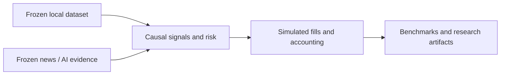

# AI-Assisted Quantitative Trading Research Framework

**Offline quantitative research · bounded AI/news evaluation · reproducible systems experiments**

This repository contains a Python research framework for studying deterministic US equity/ETF strategies, testing whether a constrained AI news-risk overlay adds value, and examining the reliability of locally orchestrated research workflows. It combines quantitative experimentation with software-engineering correctness, rather than aiming to operate a trading account.

- **Maintainer:** Michail Athanasios Peppas
- **Project direction:** v0.7 research framework (Option B)
- **Current status:** **R1–R3 reviewed baseline; R4-A synthetic historical-data infrastructure implemented — independent acceptance pending; empirical research pending**

> **No deployment, live trading or broker-connected paper trading is part of this project scope.** The canonical research path runs locally and offline. The synthetic demonstration verifies software behavior; it is not a historical-market study or an investment recommendation.

## Research questions

1. **Strategy robustness:** How do regime, trend, breakout, relative-strength and risk filters compare with transparent benchmarks under time-aware validation and changing costs?
2. **Bounded AI contribution:** Does frozen, timestamp-valid, negative-only news-risk analysis improve or worsen results compared with identical deterministic decisions and neutral AI?
3. **Systems correctness:** Can locally orchestrated computations preserve idempotency, auditability and state integrity under retries, replay and injected failures?

The evaluation is designed to report negative or inconclusive findings as faithfully as positive ones. No profitability threshold is a completion requirement.

## What exists and what remains

| Area | Current codebase | v0.7 research completion target |
| --- | --- | --- |
| Market data | Compatible v1 snapshots plus explicit v2 raw/action/identity/revision contract; mocked Alpaca SIP acquisition boundary | Properly licensed and independently qualified historical snapshots |
| Strategy and risk | Causal features, regime/candidates, full research cooldown, registered filter ablations and numerical safeguards | Historical validation with audited design exposure |
| Backtesting | Preserved next-session simulator; isolated split/dividend accounting and three explicit analytical return conventions | Authorized v2 strategy integration and historical comparisons |
| AI/news | Offline as-of frozen replay, provenance, neutral fallback and paired execution bounds | Credible frozen historical news evidence and inconclusive/negative findings retained |
| Persistence and workflows | Optional local Temporal research workflow, SQLite experiment ledger, retry/replay and verified publication reconciliation | Preserve reviewed local guarantees; no production durability claim |
| Validation and reporting | Chronological matrix, fixed-seed uncertainty, cost stresses and deterministic nested artifacts; static historical preview | Empirical report and local research-results presentation |

The research CLI connects deterministic strategy/risk logic to simulated accounting. Its R2
`evaluate` command executes registered folds, benchmarks, ablations, cost stresses, uncertainty
and frozen AI comparisons. Executed examples are synthetic engineering demonstrations;
empirical historical findings remain **pending**. Optional R3 orchestration adds local
SQLite/Temporal recovery without changing ordinary research execution. The legacy explicit-signal
backtester retains its original timing. The incomplete prior paper-validation record is not v0.7 evidence.

## Research architecture



The R1/R2 pipeline operates without Temporal or network services. A separate optional
local Temporal/SQLite track executes the same research core and verifies retries,
replay and reconciliation across separate database and filesystem commits.

### Implementation checkpoints

| Checkpoint | Evidence required | Status |
| --- | --- | --- |
| **R1 — Data and simulation** | Auditable offline snapshot, causal strategy-to-simulation path and verified arithmetic | Implemented; reviewed cooldown correction included |
| **R2 — Experiments and AI** | Benchmarks, time-aware splits, cost/ablation/uncertainty tests, frozen AI comparison | Independent external engineering review passed at `9b3678b` |
| **R3 — Local reliability** | Real local Temporal workflow, idempotent checkpoints and fault-recovery tests | Reviewed baseline at `60dd250` |
| **R4 — Portfolio release** | Reproducible example, available-data results, technical report, limitations and local presentation | R4-A infrastructure implemented; independent acceptance and empirical release pending |

Implementation is organized into these **four** bounded Codex checkpoints. The detailed task-by-task plan is available below; no deployment step is included.

R4 is proceeding in separately authorized phases. **R4-A uses only original synthetic
fixtures and mocked HTTP**: [contracts and limitations](docs/research/R4A_IMPLEMENTATION.md),
[acquisition interfaces](docs/research/R4A_ACQUISITION.md) and
[verification](docs/research/R4A_VERIFICATION.md). Alpaca is the preferred candidate,
but written entitlement/storage/retention/publication clarification is pending.
No historical acquisition or empirical R4 execution has begun. The separate synthetic
qualification command does not replace the existing research CLI or activate R3 workers.

## Documentation and research design

- **[Research framework specification v0.7](docs/app/AI_Assisted_Quant_Research_SPEC_v0.7.md):** goals, mandatory boundaries, contracts and release criteria.
- **[Research protocol](docs/research/RESEARCH_PROTOCOL.md):** hypotheses, temporal splits, benchmarks, ablations, cost models, statistics and claim policy.
- **[Research architecture](docs/research/ARCHITECTURE.md):** existing components, proposed interfaces and local reliability boundaries.
- **[Four-checkpoint implementation plan](docs/superpowers/plans/2026-11-16-ai-assisted-quant-research.md):** test-first tasks and review gates for Codex.
- **[Four Codex prompts](docs/research/CODEX_CHECKPOINT_PROMPTS.md):** one bounded, copy-ready prompt for each reviewed checkpoint.
- **[Technical documentation index](docs/README.md):** current research documents and clearly marked historical implementation/runbooks.

## Run the offline synthetic reference

These commands run offline after dependency setup. Market/news inputs are original synthetic
fixtures, including a synthetic weekday calendar and hand-authored AI outputs.

Prerequisites: Python **3.12+** and [uv](https://docs.astral.sh/uv/).

```bash
git clone https://github.com/ntua-el21026/ai-assisted-quant-research.git
cd ai-assisted-quant-research
uv sync --locked --group dev
uv run --offline --no-sync pytest tests/unit tests/integration/test_research_cli.py -q
uv run --offline --no-sync python -m packages.research.cli run \
  --config experiments/configs/baseline.yaml \
  --dataset tests/fixtures/market_snapshot/manifest.json \
  --output results/r1-example
uv run --offline --no-sync python -m packages.research.cli evaluate \
  --config experiments/configs/ablations.yaml \
  --dataset tests/fixtures/market_snapshot/manifest.json \
  --output results/r2-example
```

Use a new output directory for each run; existing outputs are immutable. The command writes
hash-indexed manifests, decision/fill records, equity, accounting metrics and a generated
report. Runtime-only timestamps and host details are separated into `runtime.json`.
See [R1 implementation and verification](docs/research/R1_IMPLEMENTATION.md) for contracts,
limitations and accounting fixtures. [R2 verification](docs/research/R2_VERIFICATION.md)
records interfaces, numerical checks, benchmarks and reproducibility hashes. The matrix
defaults to development folds; `--include-final` explicitly adds the registered synthetic
final evaluation. This does not establish an untouched historical holdout. The empirical
research study remains pending.

### Optional local workflow and replay

With an already available Temporal SDK test-server executable, run one finite local
workflow. This command never downloads a server or connects to Temporal Cloud:

```bash
uv run --offline --no-sync python -m apps.workers.app.research_local \
  --experiment-id synthetic-local-example --config experiments/configs/ablations.yaml \
  --dataset tests/fixtures/market_snapshot/manifest.json --state results/r3-example \
  --test-server-binary /path/to/existing/temporal-test-server
```

Repeat the same request and state directory to reuse the verified committed result.
Changed inputs/source/environment under the same identity fail explicitly. The command
shuts down its worker/server, retains an execution history and verifies deterministic
replay. [R3 verification](docs/research/R3_VERIFICATION.md) documents the lifecycle,
failure matrix, exact evidence and bounded crash/concurrency assumptions. SQLite and
artifact publication are separate commits; recovery verifies each boundary.

## Source organization

| Directory | Responsibility |
| --- | --- |
| [`packages/data/`](packages/data/) | Typed observations, causal features and validated local snapshots |
| [`packages/strategy/`](packages/strategy/) / [`packages/risk/`](packages/risk/) | Deterministic selection and risk contracts |
| [`packages/backtesting/`](packages/backtesting/) | Causal next-session simulator and preserved explicit-signal legacy API |
| [`packages/ai/`](packages/ai/) | Structured news-risk analysis and restrictive fallback policy |
| [`packages/ledger/`](packages/ledger/) | Local SQLite repositories and historical audit interfaces |
| [`apps/workers/`](apps/workers/) | Optional local research workflow and preserved historical Temporal scaffolding |
| [`tests/`](tests/) | Unit, integration, failure and local orchestration coverage |
| [`docs/evidence/`](docs/evidence/) | Historical operational observations, **not v0.7 research results** |

[`packages/research/`](packages/research/) provides the offline CLI, configuration, decisions and artifacts.
[`experiments/configs/baseline.yaml`](experiments/configs/baseline.yaml) freezes the R1 synthetic baseline.

## Safety, provenance and historical context

- The research pipeline must use **frozen local inputs**, deterministic time ordering, versioned configurations and published artifact hashes. No provider credentials are necessary for the reference example.
- AI is a strictly advisory, non-increasing risk overlay. It cannot create or dispatch orders, expand position size or relax deterministic limits.
- Synthetic fixtures, licensed historical observations and frozen AI outputs must be clearly distinguished. Data redistribution and survivorship/holdout limitations must be documented.
- Legacy deployment manifests, broker adapters, paper-operation scripts and readiness documents are retained for historical engineering context; **they are not active deployment instructions or completion gates**.

The historical [v0.6 specification](docs/app/Autonomous_AI_Trading_Bot_SPEC_v0.6.md) and [earlier milestone README](docs/history/readme-before-portfolio-preparation.md) are preserved for traceability. The v0.7 specification supersedes their operational objectives.

## License

See [LICENSE](LICENSE) for the repository license. Any separately sourced market/news datasets remain governed by their respective licenses.
