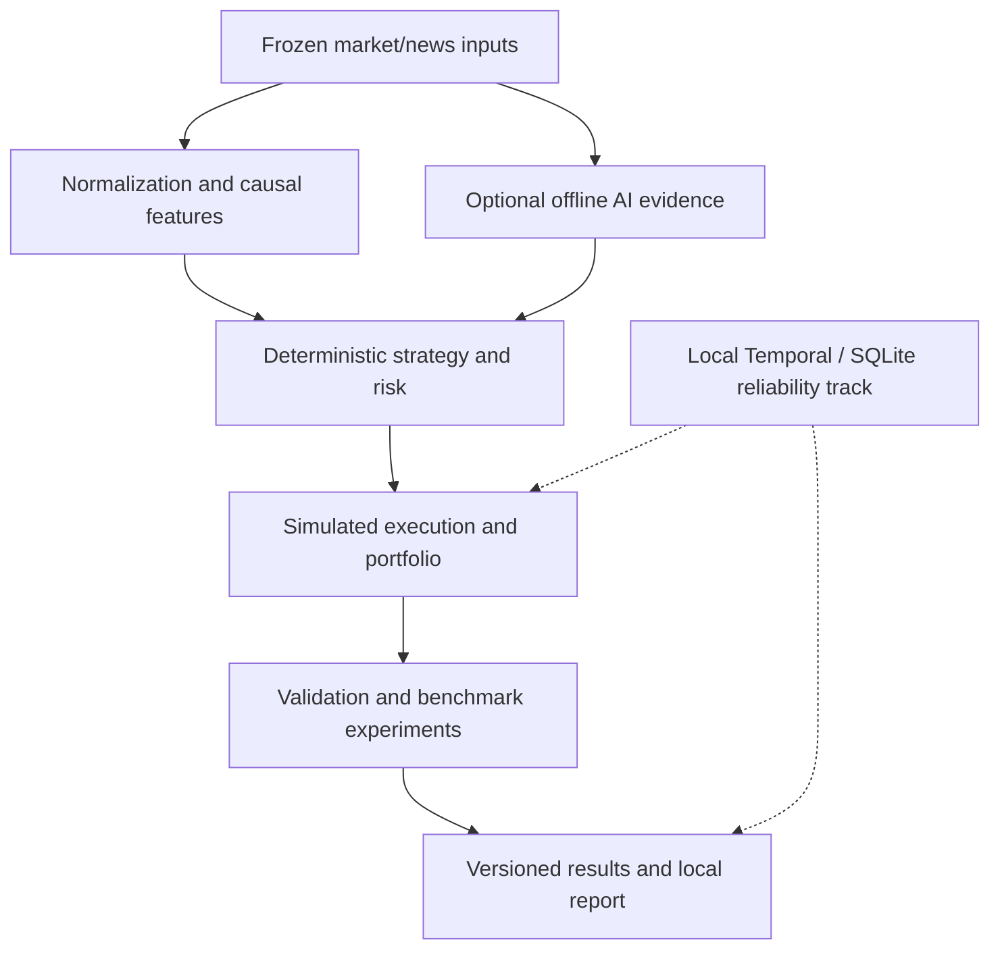
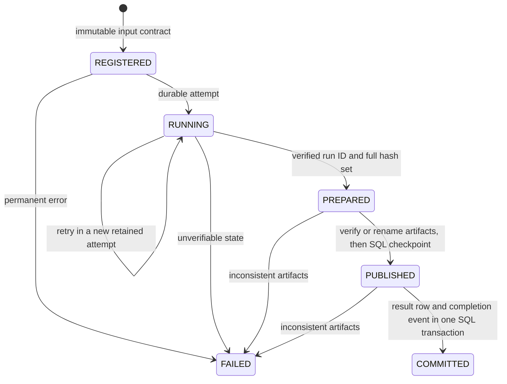

# Quantitative Trading Research Architecture — v0.7

- **Authority:** [Research Framework Specification v0.7](../app/AI_Assisted_Quant_Research_SPEC_v0.7.md)
- **Status:** R1–R3 implemented; R2 external engineering review passed, R3 independent acceptance and R4 remain pending

## 1. System boundary

This project is an **offline-first research framework**, not an execution service. The main research runner accepts explicit, integrity-checked historical inputs and produces deterministic, auditable experiment artifacts. It must not require a running API, broker account, Temporal Cloud, VPS, Vercel, Telegram or managed database.



All arrows denote local data movement or controlled function calls. The Temporal track is optional for the research-core CLI but mandatory for the systems-evidence component of the completed Option B project.

## 2. Existing reusable components

| Area | Existing source | Current evidence/status |
| --- | --- | --- |
| Config and safety | `packages/core/`, `config/` | Typed models and conservative paper/live defaults; keep flags disabled |
| Market data and features | `packages/data/` | OHLCV models, indicators, provider boundaries, Tiingo EOD adapter; versioned snapshot provenance/quality/availability gates implemented in R1 |
| Strategy and exits | `packages/strategy/` | Candidate/regime/filter and exit helpers; causal R1 decision adapter records accepted/rejected candidates |
| Risk and intent | `packages/risk/`, `packages/execution/` | Deterministic risk and intent contracts; R1 numerical simulation adapter reuses checks without operational broker assertions |
| Backtest | `packages/backtesting/` | Preserved legacy engine plus independently tested causal next-session R1 simulator |
| AI/news | `packages/ai/`, `packages/research/ai_replay.py` | Lazy legacy API, local frozen as-of replay, negative-only sizing and neutral fallback; provider clients stay outside canonical runs |
| Local demonstration | `packages/paper/dry_run.py` | Fake broker/SQLite/report pipeline exists; fixture demonstration is not multi-year research |
| Ledger and reporting | `packages/ledger/`, `packages/reporting/` | Repositories and generators exist; R1 artifact writer implemented separately from legacy persistence |
| Temporal | `apps/workers/app/` | Dedicated real research workflow/activity, finite local SDK runner and replay/recovery tests; ten legacy skeletons preserved |
| Dashboard | `apps/dashboard/` | Static safety-preview scaffold; not a research-results viewer |

## 3. Source organization and remaining additions

Reuse the existing package structure and keep new files focused. Exact signatures and incremental changes are defined in the [implementation plan](../superpowers/plans/2026-11-16-ai-assisted-quant-research.md).

```text
packages/
  data/            # Existing OHLCV/feature code; add snapshot manifests and quality gates
  strategy/        # Reuse deterministic candidates, regime and exits
  risk/            # Reuse risk constraints through simulation-safe adapters
  backtesting/     # Correct execution accounting, timing and metrics
  ai/              # Reuse parsers, scoring, provider-agnostic policy
  research/        # New experiment config, offline orchestration, validation, artifacts
  ledger/          # Existing local persistence contracts
apps/
  workers/app/     # Add a small local research workflow, preserve legacy skeletons
  dashboard/       # Optional generated static results view; no privileged browser calls
experiments/
  configs/         # Versioned baseline, costs, ablations and reproducibility seeds
datasets/
  README.md        # Snapshot format, license/provenance instructions; no licensed raw data
tests/
  fixtures/        # License-safe hand-audited market/news examples
  unit/            # Numerical and causal invariants
  integration/     # Offline end-to-end experiment checks
  temporal/        # SDK local replay and failure scenarios
results/           # Generated local outputs, ignored by default; explicitly vet any reference artifacts
docs/research/     # Protocol, architecture and verified results/report
```

New code should not duplicate existing functionality merely to satisfy this shape. During implementation, prefer adapters and tested extensions to wholesale rewrites. Large historic modules may be split only where the task's tests justify a cohesive boundary.

## 4. Canonical research interface

R1 exposes a local CLI with an explicit configuration and dataset snapshot:

```bash
uv run --offline --no-sync python -m packages.research.cli run \
  --config experiments/configs/baseline.yaml \
  --dataset tests/fixtures/market_snapshot/manifest.json \
  --output results/example
```

**Implemented in R1.** The canonical runner refuses missing/invalid inputs, avoids network and broker imports, uses deterministic ordering and stages all artifacts before atomic publication. [R1 contracts and limitations](R1_IMPLEMENTATION.md) document this compatible path.

R2 adds `python -m packages.research.cli evaluate --config experiments/configs/ablations.yaml
--dataset tests/fixtures/market_snapshot/manifest.json --output results/r2-example`.
`validation.py` registers anchored folds, fixed ablations/costs, opt-in final evaluation and
paired AI policies. `metrics.py`, `benchmarks.py` and `resampling.py` provide explicit
statistical conventions and undefined reasons. `matrix_artifacts.py` publishes a root matrix
and complete versioned case records. See [executed R2 verification](R2_VERIFICATION.md).
Optional R3 orchestration is documented below. Read-only provider acquisition, if later implemented, uses a
different explicit command.

The run output is an immutable experiment record identified by data/config/code hashes and a seed. A preview dashboard, if included, consumes **only these generated local files** and does not issue control actions.

## 5. Research correctness boundaries

- **Data boundary:** source validation, finite OHLCV, unique session rows, corporate-action and calendar policy, snapshot hashes, sufficient warm-up, no look-ahead.
- **Strategy boundary:** deterministic signal timestamps, accepted and rejected candidates, versioned parameters, no future-derived universe or ranks.
- **AI boundary:** as-of-valid frozen inputs, strict schema, negative-only sizing/blocks,
  neutral fallback, and hashes of declared and resolved evidence (including missing files).
  A neutral shadow checks executable entry identity/quantity at the eligible opening;
  vetoes cannot release capacity for replacement trades. Session gross USD exposure is
  bounded by the paired control. Equity-normalized ratios retain each portfolio's denominator.
  Candidate generation never reads later neutral fills. No broker authority exists.
- **Simulator boundary:** next-session eligible fills, cost model, stop/gap treatment, cash/positions/equity conservation, no unexplained order duplication.
- **Evaluation boundary:** frozen splits, benchmark alignment, ablations and Monte Carlo seeded before the final evaluation, every metric traceable to inputs.
- **Artifact boundary:** canonical records, atomic writes, stable run IDs, source/config hashes, no secrets or proprietary payloads.

The first end-to-end integration test should run entirely on the synthetic fixture with fixed expected positions, cash, equity, trade count, reject codes and artifact hashes. Only then should real historical experiments begin.

## 6. Local reliability track

The optional `ResearchExperimentWorkflow` invokes a typed `ResearchActivities.run` that
executes the unchanged `run_research` or `evaluate_research` pipeline. Filesystem,
source/environment validation and SQLite I/O remain in the activity; replay executes
only deterministic orchestration. The dedicated local CLI uses the SDK test environment
with an explicit existing executable and terminates after one workflow/history/replay.
It does not register historical broker/provider activities or alter legacy queues.

`packages/research/research_ledger.py` defines a small `ResearchLedger` protocol and a
separate local SQLite schema. The legacy broker schema and its transaction-owning
repositories remain unchanged. `reliability.py` owns verification and reconciliation.



The experiment key, canonical request fingerprint, runner ID and destination have
uniqueness constraints. The request pins config/base/market/AI resolution, source,
orchestration code, environment, mode and final-evaluation flag. Short explicit SQLite
transactions atomically update lifecycle records and append checked progress events.
A cooperative POSIX advisory lock serializes each experiment's execution; the kernel
releases it on process exit. A filename's presence is never treated as active ownership.
A separate short initialization lock covers the first marker write and database creation,
so a concurrent caller sees retryable contention rather than a false corruption diagnosis.

The runner first publishes into a private attempt directory. PREPARED durably anchors
the exact deterministic artifact hashes and a separate runtime-byte digest before that
directory is renamed to `runs/<run_id>`. Runtime remains excluded from reproducible
research hashes, while its original bytes are immutable within one attempt.
The filesystem rename and SQLite transitions **are not one atomic transaction**:

| Persisted condition | Deterministic action |
| --- | --- |
| REGISTERED/RUNNING without anchored output | Retain prior attempt evidence and compute in a new attempt |
| PREPARED with only exact matching private output | Rename to final, verify, then advance SQL |
| PREPARED with only exact matching final output | Reconcile an interrupted post-rename transition |
| PUBLISHED with matching final output | Commit result and completion event once |
| COMMITTED with matching final output | Return the same verified result without new effects |
| Missing/changed artifacts, conflicting identity, stage and final both present, lost ledger or invalid SQL/event state | Fail closed and preserve evidence |

Verification checks the full recursive inventory, safe regular paths, every digest,
manifest/index agreement, expected aggregate, original request binding and database
event/result consistency. COMMITTED is immutable evidence of a past commit; each return
revalidates current artifacts, and later corruption raises an error without rewriting
the original successful ledger history. Uncommitted permanent failures enter FAILED.

Exactly-once claims concern observable committed results and completion records.
Private computation can run more than once, and retry attempt records legitimately
differ. Controlled process death after rename verifies kernel-lock release and recovery;
worker/history tests verify the separately documented local SDK scenarios. This is
single-host cooperative evidence, not a distributed lease, hostile-writer protection,
power-loss proof or production service guarantee. See [R3 verification](R3_VERIFICATION.md).

The systems demonstration checks functional behavior:

1. A typed local workflow invokes a real research activity and writes an identifiable experiment result.
2. Repeated execution with the same experiment ID is idempotent and does not duplicate committed artifacts or ledger side effects.
3. Injected activity failure/retry and worker restart/replay preserve the expected final state.
4. A corrupted or inconsistent ledger/simulation snapshot fails closed, with evidence and no hidden recovery that changes results.
5. All Temporal tests use the SDK's local test environment and fake side effects; no cloud namespace or real orders.

Existing production-oriented workflow skeletons remain historical context. The dedicated
research workflow supplies the new R3 evidence; skeleton registration is not counted as
research execution. R4 empirical research and presentation remain separate work.

## 7. Historical operational boundary

The v0.6 deployment stack (`Dockerfile.paper-runner`, `docker-compose.paper-runner.yml`, `deploy/systemd/`, `vercel.json`), broker-write smoke tools, Level 4 checklists and paper-validation evidence are **legacy historical materials**. Do not execute these paths during v0.7 implementation and do not delete or rewrite their evidence to make results appear better.

The active documentation and research CLI must clearly identify them as out of scope. Removing obsolete infrastructure files is a separate explicit maintenance decision, not part of the four Codex implementation prompts.

## 8. Acceptance ownership

| Workstream | Codex produces | Independent review checks |
| --- | --- | --- |
| R1: Research core | Offline loader, causal backtest, connected strategy and numerical tests | No look-ahead, correct accounting, fixture parity |
| R2: Experiments/AI | Reproducible validation and AI comparisons | Splits, baselines, statistical definitions, provenance |
| R3: Local systems | Functional local Temporal/SQLite evidence | State equivalence, retries, idempotence, fail-closed behavior |
| R4: Release | Actual executed results, report, preview, full test logs | Claim accuracy, reproducibility, link/secret review, no deployment |

The final README and CV/project descriptions must be evidence-led. If any required component fails a gate, the project remains in development rather than receiving a cosmetic "complete" label.
