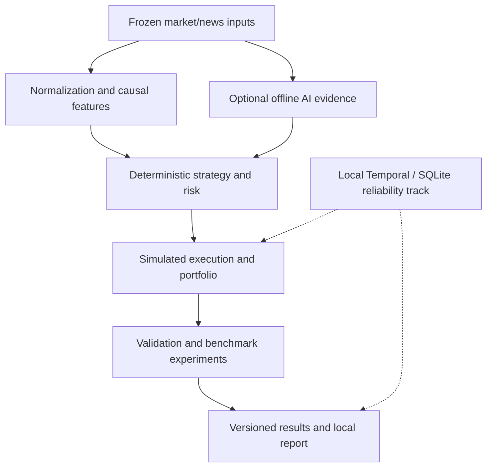

# Endeavour v0.7 Research Architecture

- **Authority:** [Research Framework Specification v0.7](../app/Endeavour_Research_Framework_SPEC_v0.7.md)
- **Status:** Target architecture; individual parts below are marked as implemented, partial or planned

## 1. System boundary

Endeavour is an **offline-first research framework**, not an execution service. The main research runner accepts explicit, integrity-checked historical inputs and produces deterministic, auditable experiment artifacts. It must not require a running API, broker account, Temporal Cloud, VPS, Vercel, Telegram or managed database.



All arrows denote local data movement or controlled function calls. The Temporal track is optional for the research-core CLI but mandatory for the systems-evidence component of the completed Option B project.

## 2. Existing reusable components

| Area | Existing source | Current evidence/status |
| --- | --- | --- |
| Config and safety | `packages/core/`, `config/` | Typed models and conservative paper/live defaults; keep flags disabled |
| Market data and features | `packages/data/` | OHLCV models, indicators, provider boundaries, Tiingo EOD adapter; snapshot provenance pipeline missing |
| Strategy and exits | `packages/strategy/` | Candidate/regime/filter and exit helpers; not integrated with historical backtest decisions |
| Risk and intent | `packages/risk/`, `packages/execution/` | Deterministic risk and intent contracts; require a simulation-specific integration |
| Backtest | `packages/backtesting/` | Explicit-signal long-only same-day-close engine, basic metrics; must be audited/corrected for causal research |
| AI/news | `packages/ai/` | Provider clients, parsing, budgets, scoring and neutral fallback; frozen as-of experiment path absent |
| Local demonstration | `packages/paper/dry_run.py` | Fake broker/SQLite/report pipeline exists; fixture demonstration is not multi-year research |
| Ledger and reporting | `packages/ledger/`, `packages/reporting/` | Repositories and generators exist; experiment artifacts still need integration |
| Temporal | `apps/workers/app/` | Ten workflow skeletons, activity contracts, local SDK test/replay coverage; not end-to-end research orchestration |
| Dashboard | `apps/dashboard/` | Static safety-preview scaffold; not a research-results viewer |

## 3. Proposed source organization

Reuse the existing package structure and keep new files focused. Exact signatures and incremental changes are defined in the [implementation plan](../superpowers/plans/2026-11-16-endeavour-research-framework.md).

```text
packages/
  data/            # Existing OHLCV/feature code; add snapshot manifests and quality gates
  strategy/        # Reuse deterministic candidates, regime and exits
  risk/            # Reuse risk constraints through simulation-safe adapters
  backtesting/     # Correct execution accounting, timing and metrics
  ai/              # Reuse parsers, scoring, provider-agnostic policy
  research/        # New experiment config, offline orchestration, validation, artifacts
  ledger/          # Existing local persistence contracts
apps/
  workers/app/     # Add a small local research workflow, preserve legacy skeletons
  dashboard/       # Optional generated static results view; no privileged browser calls
experiments/
  configs/         # Versioned baseline, costs, ablations and reproducibility seeds
datasets/
  README.md        # Snapshot format, license/provenance instructions; no licensed raw data
tests/
  fixtures/        # License-safe hand-audited market/news examples
  unit/            # Numerical and causal invariants
  integration/     # Offline end-to-end experiment checks
  temporal/        # SDK local replay and failure scenarios
results/           # Generated local outputs, ignored by default; explicitly vet any reference artifacts
docs/research/     # Protocol, architecture and verified results/report
```

New code should not duplicate existing functionality merely to satisfy this shape. During implementation, prefer adapters and tested extensions to wholesale rewrites. Large historic modules may be split only where the task's tests justify a cohesive boundary.

## 4. Canonical research interface

The finished framework must expose a local CLI with an explicit configuration and dataset snapshot, conceptually:

```bash
uv run python -m packages.research.cli run \
  --config experiments/configs/baseline.yaml \
  --dataset datasets/example/manifest.json \
  --output results/example
```

**This is a target interface, not yet an implemented command.** The canonical runner must refuse missing/invalid inputs, avoid network and broker imports with side effects, use deterministic ordering and write all defined artifacts atomically or fail with a recorded error. Read-only provider acquisition, if later implemented, uses a different explicit command.

The run output is an immutable experiment record identified by data/config/code hashes and a seed. A preview dashboard, if included, consumes **only these generated local files** and does not issue control actions.

## 5. Research correctness boundaries

- **Data boundary:** source validation, finite OHLCV, unique session rows, corporate-action and calendar policy, snapshot hashes, sufficient warm-up, no look-ahead.
- **Strategy boundary:** deterministic signal timestamps, accepted and rejected candidates, versioned parameters, no future-derived universe or ranks.
- **AI boundary:** as-of-valid frozen inputs, strict schema, negative-only sizing/blocks, neutral fallback, no broker authority.
- **Simulator boundary:** next-session eligible fills, cost model, stop/gap treatment, cash/positions/equity conservation, no unexplained order duplication.
- **Evaluation boundary:** frozen splits, benchmark alignment, ablations and Monte Carlo seeded before the final evaluation, every metric traceable to inputs.
- **Artifact boundary:** canonical records, atomic writes, stable run IDs, source/config hashes, no secrets or proprietary payloads.

The first end-to-end integration test should run entirely on the synthetic fixture with fixed expected positions, cash, equity, trade count, reject codes and artifact hashes. Only then should real historical experiments begin.

## 6. Local reliability track

The systems demonstration must prove **functional behavior**, not merely register Temporal workflow class names:

1. A typed local workflow invokes a real research activity and writes an identifiable experiment result.
2. Repeated execution with the same experiment ID is idempotent and does not duplicate committed artifacts or ledger side effects.
3. Injected activity failure/retry and worker restart/replay preserve the expected final state.
4. A corrupted or inconsistent ledger/simulation snapshot fails closed, with evidence and no hidden recovery that changes results.
5. All Temporal tests use the SDK's local test environment and fake side effects; no cloud namespace or real orders.

Existing production-oriented workflow skeletons may remain for historical context, but they are not the canonical research workflow and should not be counted as implemented reliability experiments.

## 7. Historical operational boundary

The v0.6 deployment stack (`Dockerfile.paper-runner`, `docker-compose.paper-runner.yml`, `deploy/systemd/`, `vercel.json`), broker-write smoke tools, Level 4 checklists and paper-validation evidence are **legacy historical materials**. Do not execute these paths during v0.7 implementation and do not delete or rewrite their evidence to make results appear better.

The active documentation and research CLI must clearly identify them as out of scope. Removing obsolete infrastructure files is a separate explicit maintenance decision, not part of the four Codex implementation prompts.

## 8. Acceptance ownership

| Workstream | Codex produces | Independent review checks |
| --- | --- | --- |
| R1: Research core | Offline loader, causal backtest, connected strategy and numerical tests | No look-ahead, correct accounting, fixture parity |
| R2: Experiments/AI | Reproducible validation and AI comparisons | Splits, baselines, statistical definitions, provenance |
| R3: Local systems | Functional local Temporal/SQLite evidence | State equivalence, retries, idempotence, fail-closed behavior |
| R4: Release | Actual executed results, report, preview, full test logs | Claim accuracy, reproducibility, link/secret review, no deployment |

The final README and CV/project descriptions must be evidence-led. If any required component fails a gate, the project remains in development rather than receiving a cosmetic "complete" label.
